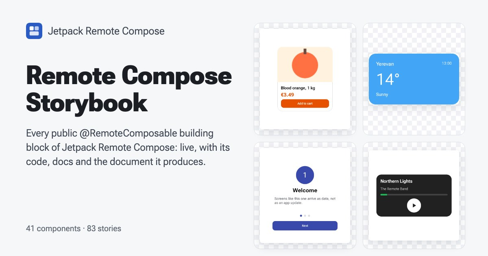

# Remote Compose Storybook

[](https://github.com/ardmn/remote-compose-storybook/actions/workflows/pages.yml)
[](https://ardmn.github.io/remote-compose-storybook/)
[](LICENSE)

**Every Jetpack Remote Compose component, live in your browser: an interactive demo, the Kotlin code and the API for each one.**

**Live site: https://ardmn.github.io/remote-compose-storybook/**

[](https://ardmn.github.io/remote-compose-storybook/)

Remote Compose (`androidx.compose.remote`) is Jetpack's server-driven UI: a server describes a piece of Android UI as a small document and the app plays it, with no app release. This catalog shows what you can build with it, for developers, designers and product managers.

Playing Remote Compose in a React Native app? See [react-native-remote-compose](https://github.com/ardmn/react-native-remote-compose).

A Storybook-like static site for the public `@RemoteComposable` creation API of Jetpack Remote Compose (`androidx.compose.remote.*`). Every building block has one or more stories: Kotlin `@RemoteComposable` functions compiled to Kotlin/Wasm against [rc-players](https://github.com/yschimke/rc-players) (a Compose Multiplatform port of AndroidX's creation API, package `ee.schimke.composeai.rccreation`) and played live in the browser by rc-players' `RcEmbeddedPlayer`.

## Features

Every component explains in plain words what it is and what to use it for, so designers and product managers can see what Remote Compose can do; developers get the code, signatures and documents behind it.

The stage has a viewport size, a light or dark player theme and a centered or top-start layout. Each story has these tabs:

- **Controls**: edit the story's args; the story is re-created and replayed live.
- **Code**: the story's source rewritten to `androidx.compose.remote.*` imports, with the call for the current control values.
- **Docs**: the AndroidX API signatures for the component, taken from `api/current.txt`.
- **Document**: the remote document the story produced.
- **Changes**: the structural diff against the previous document, e.g. after changing a control.
- **Host values**: set the document's named values as the host app would; the same document replays with them, no new capture.
- **Actions**: host actions triggered in the player (for example by tapping a story that defines one).

Pages:

- **Overview**: what Remote Compose is, how to depend on it, and every component.
- **API coverage**: every public building block in the AndroidX API and the stories that cover it. The build fails when a public building block has no story. Public blocks no story can demonstrate yet (an AndroidX limitation, or API newer than the fork) are listed with the reason (`CANNOT_DEMONSTRATE` in `tools/storybook_tools.py`).

## How it works

- Stories live in `storybook/src/wasmJsMain/kotlin/rcstorybook/stories/*.kt`. They are registered with their controls in `storybook/src/wasmJsMain/kotlin/rcstorybook/catalog/*.kt`.
- `tools/storybook_tools.py` extracts each story's source (rewritten to AndroidX packages, with every `androidx.compose.remote` import checked against AndroidX's `api/current.txt`), parses the API signatures in `reference/androidx-api/*.txt`, and produces the API coverage report.
- Gradle compiles the storybook to Wasm. `web/` holds the plain HTML/JS page shell.
- `scripts/build-site.sh` assembles everything into `build/site`.
- `e2e/run.mjs` (Playwright) opens every story in Chromium and checks that it renders, that its Code and Docs tabs are populated, that changing a control produces a structural diff, and that host actions reach the Actions tab. Screenshots go to `e2e/out/`.
- `e2e/social.mjs` writes link previews: for every story a page `s/<story-id>/` with its own Open Graph tags and a 1200×630 card (`card.jpg`, the component, what it is for and the story's stage), plus the site card. Chat apps and social networks never see the `#/story/...` part of a link, so "Copy link" hands out the `s/<story-id>/` address, which opens the story with the same args. Absolute URLs use `SITE_URL`, or the GitHub Pages address of the repository.
- The same `s/<story-id>/` page (and `s/<story-id>/ru/` in Russian) is the story's static page for search engines: its explanation, a picture of its stage, its code and API signatures, structured data and links to its neighbours (`e2e/pages.mjs`). It sends a browser on to the live story only when the link has a query (the args, or `?play`, which "Copy link" adds). `social.mjs` also writes `sitemap.xml`, `llms.txt` and a static list of every component in `index.html`. After a deploy, the workflow tells IndexNow engines (Bing, Yandex) about the pages; the repository variables `GOOGLE_SITE_VERIFICATION`, `BING_SITE_VERIFICATION` and `YANDEX_VERIFICATION` add the webmaster tools' ownership tags.

## Versions

The catalog shows the API of the newest AndroidX release that rc-players' fork is cut from: `reference/androidx-api` is AndroidX's `api/current.txt` at the commit `1.0.0-alpha24` was cut from (`COMMIT`; the released versions are in `RELEASE`), and the stories run on the newest rc-players release (3.12.1, whose creation fork, 3.10.0, is cut from `cb8e6388acf` (one merge before alpha24's `a9dc564e55c`; the API files are identical)). `scripts/verify-androidx.sh` compiles every story against the released artifacts on Google Maven, and the Overview page shows the Gradle setup for them. What changed in the API since the previous release is in [`docs/alpha24-api-diff.md`](docs/alpha24-api-diff.md).

## Local development

Requirements: JDK 17, Python 3.12+ (the hashed lint lock is compiled for 3.12), Node `>=22.12.0` (what `@axe-core/playwright` in `e2e/` requires).

```sh
scripts/build-site.sh --dev            # fast, unoptimized build into build/site
python3 -m http.server 8080 -d build/site
# open http://localhost:8080
```

`scripts/build-site.sh` without `--dev` makes the optimized production build that is deployed.

End-to-end test (needs a built `build/site`):

```sh
cd e2e && npm ci && npx playwright install --with-deps chromium && node social.mjs && node run.mjs
# node run.mjs --only <story-id-substring> runs a subset
```

## Adding a story

1. Write a `@Composable @RemoteComposable` function in `storybook/src/wasmJsMain/kotlin/rcstorybook/stories/`, for example in `Layout.kt`:

```kotlin
@Composable
@RemoteComposable
fun BoxContentAlignment(contentAlignment: RemoteAlignment, boxSize: Int, childSize: Int) {
    RemoteBox(
        modifier = RemoteModifier.size(boxSize.rdp).background(Color(0xFFE3F2FD).rc),
        contentAlignment = contentAlignment,
    ) {
        RemoteBox(RemoteModifier.size(childSize.rdp).background(Color(0xFF1E88E5).rc))
    }
}
```

2. Register a `Story(...)` with its args in the matching component in a file under `storybook/src/wasmJsMain/kotlin/rcstorybook/catalog/`, for example `LayoutCatalog.kt`:

```kotlin
Story(
    id = "remote-box--content-alignment", name = "Content alignment", function = "BoxContentAlignment",
    description = "Every RemoteAlignment and RemoteAbsoluteAlignment value applied to one child.",
    args = listOf(
        choice("contentAlignment", Options.alignments, default = 4),
        int("boxSize", 220, 80, 320, step = 10),
        int("childSize", 72, 16, 200, step = 4),
    ),
) { BoxContentAlignment(it["contentAlignment"], it.int("boxSize"), it.int("childSize")) },
```

3. Rebuild with `scripts/build-site.sh --dev`. The Code tab, API coverage and e2e run pick the story up automatically.

## Updating versions

- AndroidX API: `scripts/update-androidx-api.sh <sha> <release>` (for example `a9dc564e55c 1.0.0-alpha24`) refreshes `reference/androidx-api/*.txt` from the commit an AndroidX release was cut from, records it in `reference/androidx-api/COMMIT` and the released versions in `RELEASE`, which `verify-androidx` compiles against. The commit is the one whose `remote-*-sources.jar` files match the tree (the release notes' commit range can end earlier). Without arguments it follows `androidx-main` and the newest androidx.dev snapshot instead (`SNAPSHOT_BUILD`). Rebuild afterwards: new public building blocks without a story fail the coverage check.
- rc-players: change `rc-players` in `gradle/libs.versions.toml` (the BOM's version; it pins each module, and a release republishes only the modules that changed), rebuild, and re-check `CANNOT_DEMONSTRATE`.
- Any library that ships in the site (rc-players, Kotlin, Compose, coroutines, ktor): after the change run `./gradlew :storybook:dependencies --write-locks` and commit `storybook/gradle.lockfile`. Until then an upgrade fails the build, and CI's lint job fails on a lock that doesn't match.

## Deployment

`.github/workflows/pages.yml` builds the site and runs the e2e test on every push to `main`, on pull requests and on manual dispatch. Pull requests only build and test. Pushes to `main` also deploy `build/site` to GitHub Pages. Dependency advisories are checked in a separate workflow, `security.yml` (below).

One-time setup: in the repository, Settings → Pages → Source: GitHub Actions.

## Static analysis

The workflow's `lint` job (the build waits for it) runs ktfmt and detekt (Kotlin), ruff and mypy (`tools/`), shellcheck, actionlint, and ESLint, Prettier and knip (`cd e2e && npm run lint`). The `secrets` job runs gitleaks on every commit reachable from the checked-out HEAD (not on other branches or tags); the deploy waits for it, so a committed secret is never deployed, while pull requests still get their build and e2e result. The separate `security.yml` workflow runs OSV-Scanner on the npm, Yarn, pip and Gradle lockfiles (`e2e/package-lock.json`, `kotlin-js-store/wasm/yarn.lock`, `tools/requirements-lint.txt`, `storybook/gradle.lockfile`) on pushes, pull requests and weekly; nothing waits for it, so a new advisory cannot block a deploy. GitHub disables the weekly schedule after 60 days without repository activity. The Gradle lockfile covers what ships in `storybook.wasm`; build tools (ktfmt, detekt, compiler plugins) are not locked and not scanned, since they never reach the site. Every tool fails on findings that are not reviewed:

- detekt: `./gradlew :storybook:detektWasmJsMainSourceSet` (`:storybook:detekt` and `check` run it too). Existing findings are in `storybook/detekt-baseline-wasmJsMainSourceSet.xml`, rewritten by `./gradlew :storybook:detektBaselineWasmJsMainSourceSet`; config in `config/detekt/detekt.yml`. Baseline entries match by rule, file name and signature (the function, or the literal for MagicNumber), not by line: a new finding with the same signature in the same file is hidden by the old entry.
- ESLint: each reviewed HTML sink in `web/` has an `eslint-disable-next-line no-unsanitized/property -- <why it is safe>` comment on the line before it (`no-unsanitized/method` for `insertAdjacentHTML` and `document.write`). A disable comment that no longer suppresses anything fails the lint; `cd e2e && npm run lint:prune-directives` removes those and reformats.
- OSV-Scanner: prefer fixing the version (for `kotlin-js-store/wasm/yarn.lock`, a Yarn resolution in `build.gradle.kts`). An advisory that does not apply goes into `osv-scanner.toml` as an `IgnoredVulns` entry for that one advisory ID, with a reason and an `effectiveUntil` date (not a `PackageOverrides` ignore, which would hide later advisories too).
- gitleaks: to accept a finding (a false positive, or a secret already revoked), add it to `.gitleaksignore` in the repository root as `<file>:<rule>:<line>` (the `Fingerprint` from the gitleaks output without its leading `<commit>:`), with a comment saying why. Keep the commit out: a squash or rebase merge gives the commit a new SHA on `main`, the entry stops matching there, and the `secrets` job then blocks the deploy.

Python lint tools are pinned with hashes in `tools/requirements-lint.txt` (from `tools/requirements-lint.in`, which has the command to regenerate it).

## License

Apache-2.0 (see `LICENSE`), as AndroidX and rc-players are. The page uses no web fonts. The sample image (`web/assets/sample.png`) is generated.
